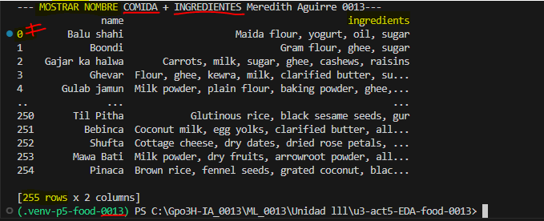
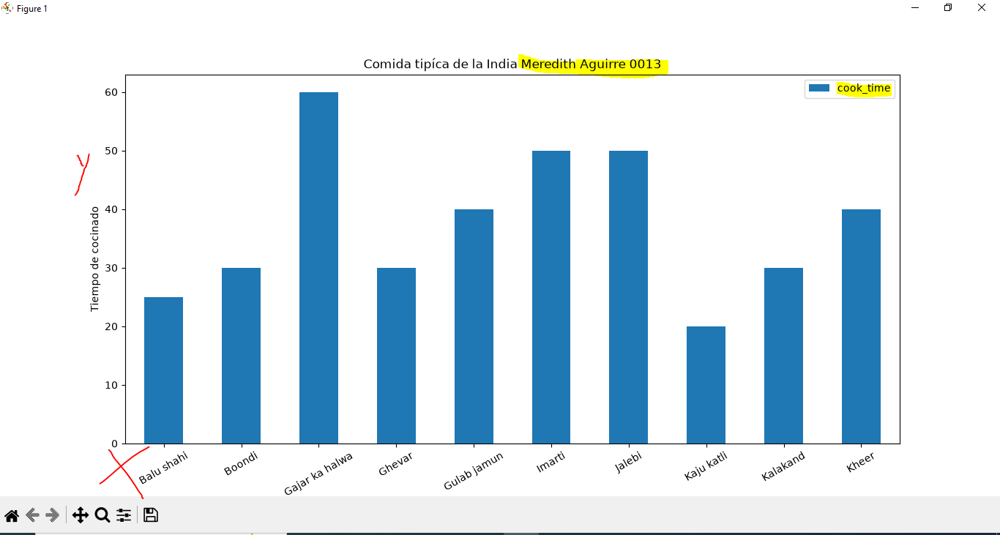
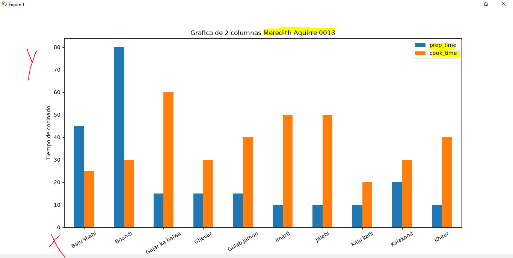
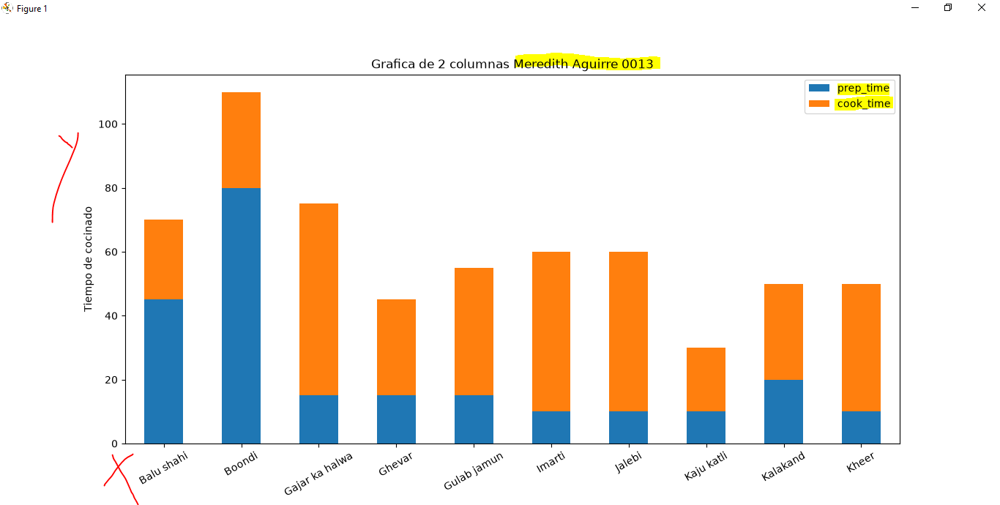

## Analisis exploratorio de datos
## Comida del país India
## Meredith Aguirre NC = 0013
## Importando datos del CSV comida de la india

## Mostrar el nombre de la comida más ingredientes

## Tiempo de cocinado en 10 registros

## Creación de Graficas

## Grafica de barras apiladas

## Grafica de columnas apiladas verticalmente una tras otra
